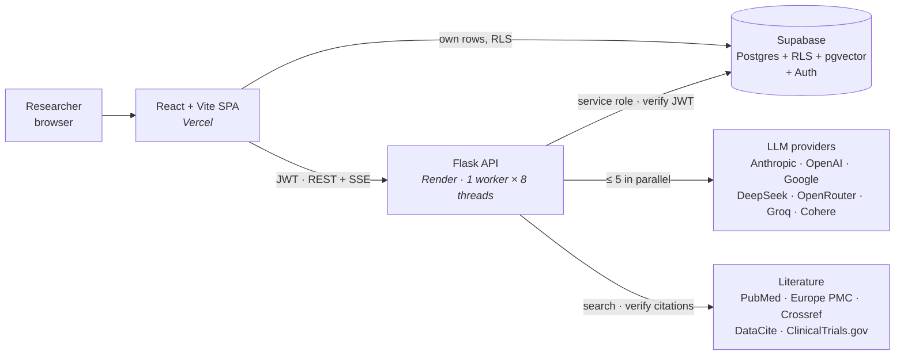
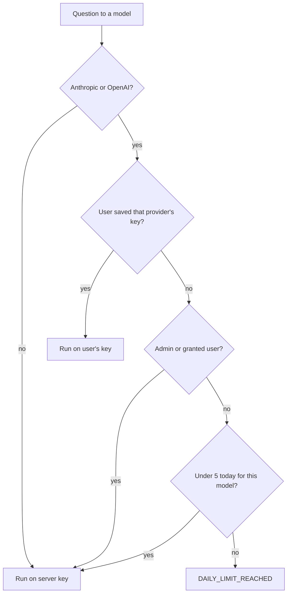
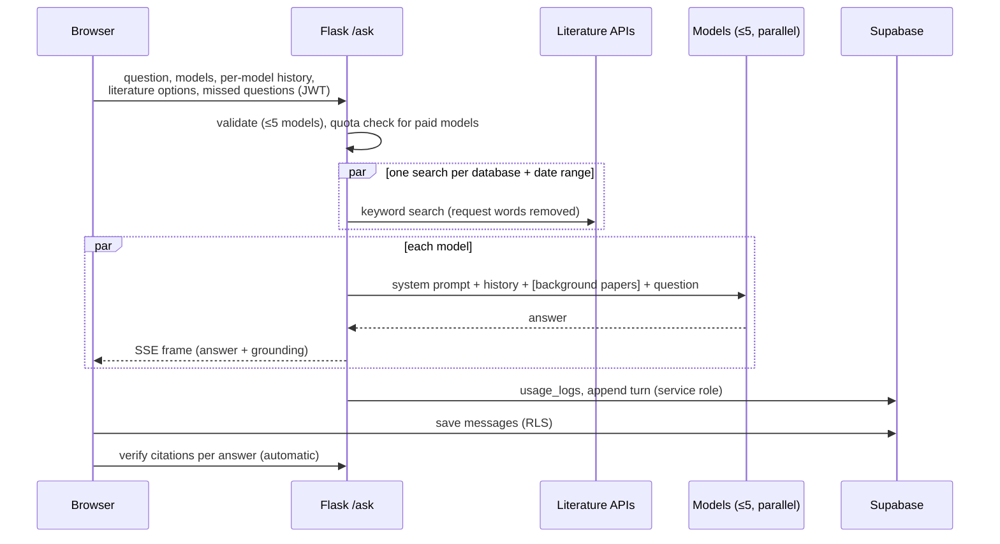
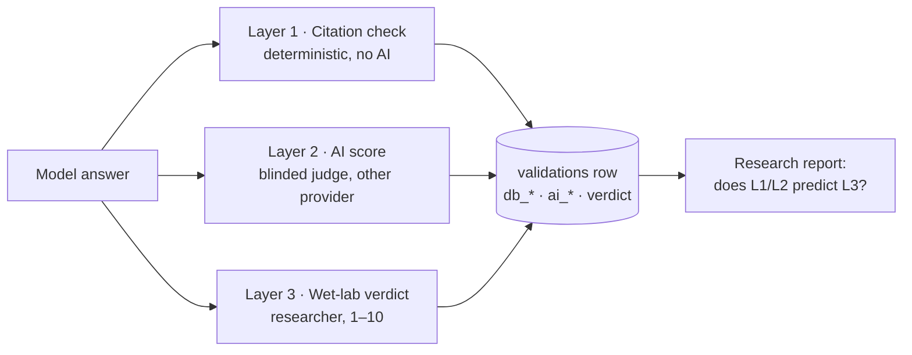
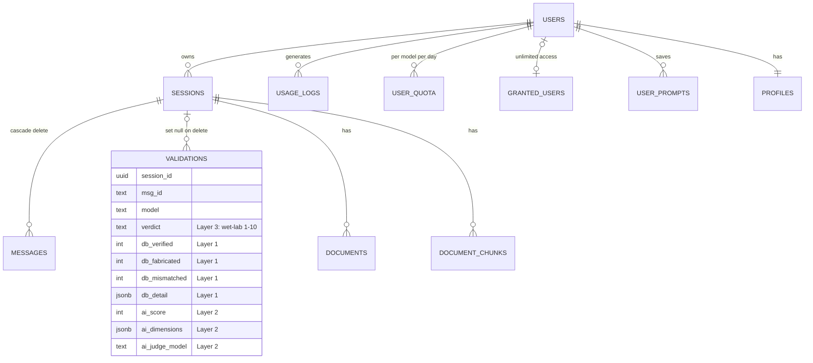

# OmniMed — System Design

OmniMed asks several large language models the same cardiovascular ncRNA
research question, shows their answers side by side, and measures how far each
answer can be trusted. Its research question: **does an automated measure of an
answer's quality predict the wet-lab outcome?** Every design choice below serves
that question: answers must stay independent, evidence must be measured
separately from opinion, and the three measures must never be blended.

---

## 1. Architecture

**Split of responsibility.** The browser talks to Supabase directly, under Row
Level Security, for data the user owns: conversations, prompts, wet-lab scores.
It calls the Flask backend only for what needs server-side secrets or
orchestration: calling models, literature search, citation checks, scoring, file
parsing, and admin operations. Provider keys and the Supabase service-role key
never reach the browser.

| Layer | Technology | Hosting |
|---|---|---|
| Frontend | React 18, Vite, React Router, Recharts, DOMPurify | Vercel (SPA rewrite) |
| Backend | Python, Flask, httpx, provider SDKs, SciPy | Render (free web service) |
| Data | Supabase Postgres, Row Level Security, pgvector | Supabase |
| Auth | Supabase Auth (email, Google OAuth); JWTs verified by the backend | Supabase |

---

## 2. Components

### Frontend (`omnimed-frontend/src`)

| Module | Responsibility |
|---|---|
| `pages/Chat.jsx` | Model boxes, sending questions, per-answer tools (citations, AI score, wet-lab score), council verdict |
| `data/models.js` | **The** list of models: labels, colours, groups, which saved key pays, defaults, retired models (for old chats) |
| `data/builtinPrompts.js` | Selectable system prompts (1-line, brief, full, miRNA Research) |
| `lib/api.js` | Authenticated fetch and the SSE reader for `/ask` |
| `lib/chatStore.js` | Conversations and messages in Supabase (localStorage as cache) |
| `lib/verifyStore.js` | Citation results and AI scores per session (browser cache) |
| `lib/apiKeys.js` | User's own API keys, kept in the browser only |
| `pages/admin/*` | Overview, reliability statistics, usage and cost, users, granted access, research report |

### Backend (`omnimed-backend`)

| Endpoint | Module | Purpose |
|---|---|---|
| `POST /ask` | `routes/chat.py` | Ask up to 5 models in parallel; stream each answer as it finishes (SSE) |
| `POST /literature/verify-citations` | `routes/literature.py` | Check every PMID, DOI and author–year citation in a text |
| `POST /literature/unsourced-claims` | `routes/literature.py` | Look for literature behind claims made without a citation |
| `POST /literature/search` | `routes/literature.py` | Search PubMed / Europe PMC / ClinicalTrials.gov |
| `POST /agent/score-all` | `routes/agent.py` | Score every answer to a question with one blinded judge |
| `POST /agent/council` | `routes/agent.py` | One verdict across all answers, candidates ranked by independent evidence |
| `POST /upload` | `routes/upload.py` | Extract text from PDF, Word, CSV and images |
| `/admin/*` | `routes/admin.py` | Granted users; research report (statistics + narrative) |
| `GET /health` | `app.py` | Liveness and which keys are configured (booleans only) |

| Service | Responsibility |
|---|---|
| `services/literature_service.py` | Search, citation verification, full-text second look, candidate profiles |
| `services/agent_service.py` | Judge and council prompts; parsing their replies |
| `services/supabase_service.py` | Data access with the service role |
| `services/rag_service.py`, `embedding_service.py` | Chunking and embedding large uploaded documents |
| `services/stats_service.py` | Descriptive statistics, ANOVA, Bonferroni-corrected pairwise tests |

---

## 3. The model layer

All 23 models live in one table, `MODELS` in `routes/chat.py`, mirrored for
display by `data/models.js`. Each entry names a provider and the provider's
model id; `_run_model` picks the caller from the provider:

| Provider | Caller | Paid by (user key → server key) |
|---|---|---|
| Anthropic | Anthropic SDK (prompt caching) | `claude` → `ANTHROPIC_API_KEY` |
| Google | google-genai SDK | `gemini` → `GEMINI_API_KEY` |
| Cohere | Cohere SDK v2 | `cohere` → `COHERE_API_KEY` |
| OpenAI, DeepSeek, OpenRouter, Groq | OpenAI-compatible client | `gpt4` / `deepseek` / `qwen` / `groq` → server key |

- **Keys are permanent.** A key is stored in `validations.model` and
  `usage_logs`, so it is never renamed or repointed; a new model gets a new key.
  Retired keys stay in `RETIRED_MODELS` so old data keeps its names.
- **Every id is checked against the provider's live model list.** Aliases are
  traps: `gemini-3.5-flash` is served as 3.6, and `deepseek-chat` as
  `deepseek-flash`.
- **Thinking is always on, for every model.** It costs output tokens but is
  what synthesis questions need, so cost is saved through caching, never by
  turning thinking off. Claude runs adaptive thinking at effort `high` (Opus 5.5
  and Haiku 5.5 would otherwise default to `medium`); the other providers reason
  by default. Qwen (OpenRouter) and Cohere get a 6,000-token thinking cap,
  because uncapped they used the whole budget and returned no answer.
- **Output limits leave room for thinking.** Thinking shares the output budget,
  so every call is raised to its provider's floor (Claude 16,000, Gemini 8,192,
  others 16,384), including the judge and council, whose replies are short.
  A limit is not a charge: only tokens actually generated are billed.
- **Failures are data.** Every caller returns `{model, status, text | error,
  usage, served_model}` with a stable error code (`RATE_LIMIT`,
  `INSUFFICIENT_CREDITS`, `TRUNCATED_BEFORE_ANSWER`…). The UI explains each code,
  and one model's failure never stops the others.

### Access and quota

The quota is counted per user, per model, per day in Postgres
(`increment_user_quota`), with an in-memory cache so blocked and granted users
cost no repeat queries. The same rule decides which judge may score answers:
a paid model is never used as a judge on the project's keys for a user who could
not ask it directly.

---

## 4. Asking a question (`/ask`)

**What each model receives** (each part only when it applies):

| Part | When | Where in the request |
|---|---|---|
| Base prompt: expert audience, one citation rule | Biomedical mode | System |
| Selected prompt (e.g. miRNA Research) | User picked one | System |
| Whole uploaded documents (small) | Files in the session | System |
| Its own earlier answers in this chat | Follow-ups | History (≤ 6 exchanges, ≤ 24k chars) |
| Background papers from PubMed / Europe PMC | Box has a database | This turn's message |
| Retrieved passages (large documents) | Large files | This turn's message |
| Earlier questions it never saw | Model joined mid-chat | This turn's message |

Three rules shape this:

- **Independence.** A model sees only its own earlier answers, never another
  model's. A model joining mid-chat is told the earlier *questions* only.
- **Cache-friendly order.** Everything identical between turns (system prompt,
  whole documents, history) comes first, and everything that changes each turn
  comes last. Anthropic gets explicit cache breakpoints; OpenAI, DeepSeek and
  Gemini cache matching prefixes automatically. Measured: by the third turn, a
  Claude conversation billed 19 tokens at full price and read 1,132 from cache.
- **Literature grounding is per box.** Boxes sharing a database and date range
  share one search. *Auto* gives the model the 25 best matches (top 8 with
  abstracts) and lets it choose; a fixed number is honoured when the user sets
  one. A date range is strict: the model is told not to cite older papers.

---

## 5. Measuring answers: three layers, never merged

**Layer 1: citation check** (`literature_service.verify_citations`)

1. Extract PMIDs, DOIs and author–year citations (handles markdown, full-width
   punctuation, Unicode hyphens, surname particles and initials).
2. Resolve them: PMIDs in one PubMed batch, DOIs via Crossref and DataCite,
   author–year via a fielded PubMed search, with a Crossref fallback that must
   match the claim's topic.
3. Check support: does the paper's title, abstract or MeSH name the claim's RNA
   or gene target? For a flagged citation, re-check against the **open-access
   full text** (Europe PMC); when no full text is available and the paper is on
   the claim's topic, report *not in abstract* rather than a miscitation.
4. Report: real, **fabricated**, **off-topic**, **retracted**, or *unconfirmed*.
   A failed lookup is never counted as fabricated.

Separately, uncited claims are searched in PubMed, and every candidate named by
any answer is profiled (paper counts, recent papers, registered trials).

**Layer 2: AI score** (`/agent/score-all`): one judge for the whole batch, never
a model being scored, never told which model wrote what. Four criteria
(evidence, mechanism, actionability, calibration); the overall score is their
average. The judge sees the Layer 1 findings (recorded as
`ai_saw_verification`, since it makes Layer 2 partly depend on Layer 1). Judge
scores are noisy; compare models over many questions.

**Layer 3: wet-lab verdict**: entered by the researcher. The only ground truth.

The three live in separate columns of one `validations` row per
(session, message, model), so the analysis can ask whether Layers 1 and 2
predict Layer 3. The research report computes per-model descriptive statistics,
a one-way ANOVA and Bonferroni-corrected Welch t-tests, and can draft a Results
paragraph.

---

## 6. Data model

- **Row Level Security everywhere.** Each table is scoped to its owner; admin
  emails can read everything; aggregate admin views run through
  `SECURITY DEFINER` functions.
- **Deleting a chat keeps its research data.** Messages cascade; validations are
  detached (`ON DELETE SET NULL`), because a wet-lab verdict must outlive the
  chat it was entered in.
- **Large documents** (over 12,000 characters) are chunked (1,100 characters),
  embedded (OpenAI `text-embedding-3-small`, 1,536 dimensions) and retrieved
  6 chunks at a time with `match_document_chunks`.

---

## 7. Security

| Concern | Control |
|---|---|
| Authentication | Every backend route requires a Supabase JWT (`require_auth`); admin routes also check the admin email list |
| Data isolation | Postgres RLS on every table; the service-role key is backend-only |
| Paying for others | 5/day per paid model; judges filtered by the same rule; OpenRouter keys pay only for Qwen |
| Abuse limits | 5 models per question; 8 answers per scoring request; 100k characters and 40 citations per check; 8 full-text look-ups per answer; 50 MB uploads |
| User API keys | Stored only in the user's browser; sent per request; never persisted server-side |
| XSS | Model text is HTML-escaped, then sanitized with a DOMPurify allowlist; citation links are built from fixed `https://` prefixes |
| CORS | Restricted to the production domain and localhost (`ALLOWED_ORIGINS`) |
| Secrets in git | `.env` files ignored; Render secrets set in the dashboard (`sync: false`) |

---

## 8. Reliability and limits

| Mechanism | Value |
|---|---|
| Model call timeout | 300 s (gunicorn timeout matches) |
| Judge timeout / cooldown after failure | 45 s / 120 s |
| Busy provider | Gemini retried once after 15 s; other providers report `SERVICE_UNAVAILABLE` or `RATE_LIMIT` for the user to retry |
| PubMed rate limit | Shared limiter: 2.5 req/s, 9 with `NCBI_API_KEY`; safe across threads and event loops |
| Literature cache | 6 hours, in process |
| History sent per model | ≤ 12 messages, ≤ 24,000 characters, long answers trimmed to head and tail |
| Workers | One gunicorn worker so the in-memory quota cache stays coherent; 8 threads for concurrent streams |

---

## 9. Configuration

**Backend (Render):** `ANTHROPIC_API_KEY`, `OPENAI_API_KEY`, `GEMINI_API_KEY`,
`GROQ_API_KEY`, `DEEPSEEK_API_KEY`, `OPENROUTER_API_KEY`, `COHERE_API_KEY`,
`SUPABASE_URL`, `SUPABASE_KEY`, `SUPABASE_SERVICE_KEY`, `ADMIN_EMAIL(S)`,
`NCBI_EMAIL`, `NCBI_API_KEY` (optional), `ALLOWED_ORIGINS` (optional).

**Frontend (Vercel):** `VITE_API_URL`, `VITE_SUPABASE_URL`,
`VITE_SUPABASE_ANON_KEY`, `VITE_ADMIN_EMAIL(S)`.

**Database:** run `omnimed-backend/supabase_setup.sql` once; it is idempotent.

---

## 10. Known limitations and next steps

- **Admins can read every user's data.** Thirteen row-level policies give the
  admin emails full access (read *and* write) to all rows — chats, uploaded
  documents, prompts, scores. Planned (pending discussion with Dr. Chen):
  a personal dashboard per user (own usage, own reliability statistics, own
  report); an admin view limited to anonymous aggregates through summary
  functions; owner-only policies on chats, documents, prompts and chunks; a
  consent notice for pooling wet-lab scores; and, later, opt-in sharing with a
  lab.
- **Validation rows are written by the browser.** RLS limits a user to their own
  rows, but a user could edit their own scores. Moving these writes to the
  backend would make the research data tamper-evident.
- **Judge scores vary between runs** (the same answer has scored 4 and 9).
  Several judges per answer, averaged, would steady them.
- **"groq" changed model** on 2026-10-01 (Llama 3.3 → GPT-OSS 120B). Rows before
  that date should be analysed separately.
- **Free tiers rate-limit under load** (Groq, Gemini). Paid keys or the user's
  own keys remove this.
- **Cost estimates** cover only models with a price in the admin Usage page.
- **Next: MCP server.** Expose the same tools (ask models, verify citations,
  search literature) to Claude and ChatGPT clients, on this backend, so the
  website and the chat clients share one engine and one dataset. The
  [OmniMed Agent Skill](https://github.com/chitrashensah/omnimed-skill) already
  packages the literature tools for Claude Code.
